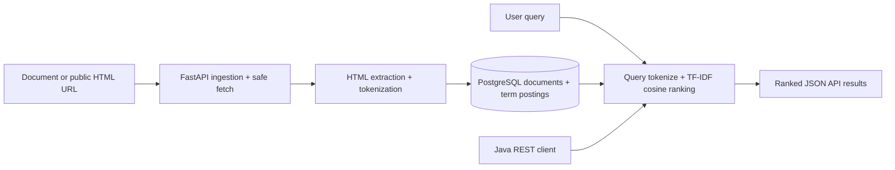

<div align="center">

# 🔎 SearchLiteX
### Mini Search Engine

**Crawl → Tokenize → Inverted Index → TF-IDF Rank → REST Search**

Python · Java 21 · FastAPI · PostgreSQL · Docker · pytest

[](https://github.com/jadu12git/SearchLiteX/actions/workflows/ci.yml)

</div>

## Overview

SearchLiteX is a document-focused search engine with an HTTP API. It ingests manually supplied documents or crawls explicitly provided public HTML URLs, maintains a PostgreSQL inverted index and ranks query matches using TF-IDF with cosine similarity. A **Java 21 command-line client** consumes the Python REST API.

## Architecture



## Features

- **HTML ingestion:** Explicit public HTTP(S) links with no redirects, public-IP checks, HTML-only responses and a 1MB body limit
- **Index:** Lowercase Unicode tokenization, term-frequency postings, and document metadata persisted in PostgreSQL
- **Ranking:** Log-scaled TF, smoothed inverse document frequency, cosine similarity; stable tie-breaking
- **Duplicate pages:** Re-crawling or re-adding the same URL updates its document and postings instead of creating duplicates
- **Search API:** Ranked results with titles, snippets, URLs and scores
- **Java:** Standalone Java 21 CLI invokes the live search endpoint
- **Tests:** pytest unit tests and actual Docker/PostgreSQL/API integration test

## Run locally

Requires Docker Desktop.

```bash
git clone https://github.com/jadu12git/SearchLiteX.git
cd SearchLiteX
docker compose up -d --build
curl http://localhost:8000/health
```

Swagger API: http://localhost:8000/docs

### Add documents

```bash
curl -X POST http://localhost:8000/api/documents \
  -H 'Content-Type: application/json' \
  -d '{"url":"https://example.org/articles/python","title":"Python Search","content":"Python search engines use inverted indexes and ranking."}'

curl -X POST http://localhost:8000/api/documents \
  -H 'Content-Type: application/json' \
  -d '{"url":"https://example.org/articles/java","title":"Java APIs","content":"Java applications communicate with REST APIs."}'
```

Crawl a public HTML page (network access required):

```bash
curl -X POST http://localhost:8000/api/crawl -H 'Content-Type: application/json' \
  -d '{"url":"https://example.com/"}'
```

Search:

```bash
curl 'http://localhost:8000/api/search?q=python%20search&limit=10'
```

Java 21 client (requires local JDK):

```bash
java java-client/SearchLiteXClient.java "python search"
```

## REST endpoints

| Method | Route | Purpose |
|---|---|---|
| GET | `/health` | Database readiness |
| POST | `/api/documents` | Add or update text by URL |
| POST | `/api/crawl` | Fetch and index one public HTML URL |
| GET | `/api/documents` | List indexed documents |
| GET | `/api/search?q=...&limit=10` | Ranked matches |
| DELETE | `/api/documents/{id}` | Remove page and postings |
| GET | `/docs` | Interactive OpenAPI documentation |

## Tests

```bash
docker compose up -d --build
python3 tests/integration.py
```

For pytest without local installation:

```bash
docker run --rm -v "$PWD":/app -w /app python:3.12-slim sh -c "pip install -r requirements.txt && pytest -q"
```

The integration suite uses actual PostgreSQL + FastAPI containers to test upserts, duplicate URL handling, TF-IDF queries, empty queries and document listing. GitHub Actions also checks Python tests, the Java client compilation, and the live integration suite. See [Actions](https://github.com/jadu12git/SearchLiteX/actions) for real results.

## Engineering trade-offs

| Decision | Benefit | Limitation |
|---|---|---|
| PostgreSQL inverted-index postings | Durable, inspectable indexing | Ranking currently loads the indexed corpus into application memory; not designed for large scale |
| TF-IDF cosine similarity | Explainable deterministic relevance | No semantic search, stemming, phrase or Boolean query operators |
| Explicit URL fetching | Constrained crawl scope | No recursive link traversal, robots.txt scheduling or crawling at scale |
| Same-URL upsert | Prevents duplicate pages on re-index | Different URLs with identical content remain separate documents |
| Java CLI over REST | Real cross-language client | Not an additional Java backend; Python implements indexing and ranking |
| Docker Compose | Reproducible local development | No authentication, TLS, observability or production orchestration |

**Security note:** The crawler rejects private/reserved DNS resolutions, disables redirects and proxy-env reliance, and restricts content size. Because DNS can change between checking and connecting, this is **not a production-grade SSRF defense**. Do not expose the crawl API publicly without stronger network egress restrictions, authentication and DNS pinning.

## Scope

Portfolio-scale educational search engine, **not Google-scale search infrastructure**. No external deployment is required; the repository contains configuration for local containerized execution. Production deployment would need authentication, quotas, robust URL fetch isolation, migrations, pagination and scalable retrieval/ranking.

**Built by [Joseph Adu](https://github.com/jadu12git).**
